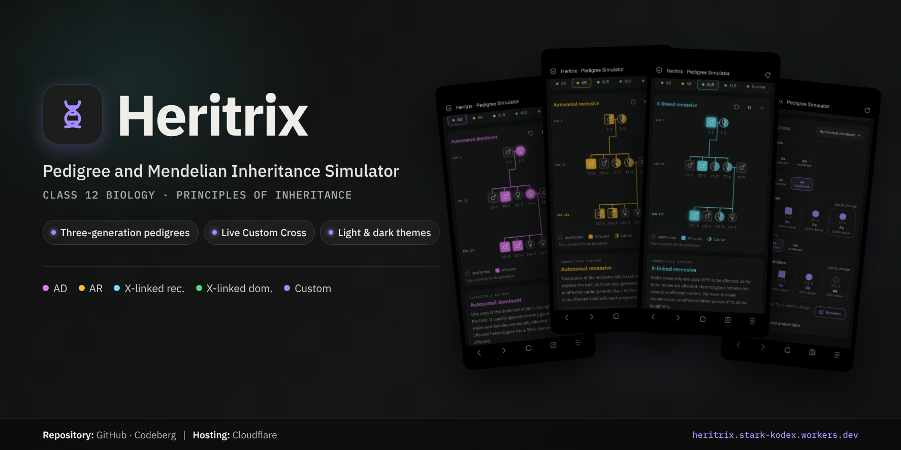

  

<h1 align="center">Heritrix</h1>

<em>Pedigree and Mendelian Inheritance Simulator</em>

<a href="https://heritrix.stark-kodex.workers.dev"><strong>Explore Heriitrix<strong></a>

  <a href="#about">About</a> ·
  <a href="#screenshots">Screenshots</a> ·
  <a href="#modes">Modes</a> ·
  <a href="#controls">Controls</a> ·
  <a href="#technology">Technology</a> ·
  <a href="#credits">Credits</a> ·
  <a href="#license">License</a>

<em>Project dedicated to Lord Vishnu</em>

---

## About

An interactive three-generation pedigree that shows how a trait passes through one family under autosomal dominant, autosomal recessive, X-linked recessive and X-linked dominant inheritance. Tap any person for their genotype and how they inherited it, or build your own family with the Custom Cross.

Runs on phones, laptops and classroom smart panels, in light and dark themes.

---

## Screenshots

<table width="100%">
  <tr>
    <td width="25%" align="center">
      
       <b>1 · Meet Heritrix</b>
    </td>
    <td width="25%" align="center">
      
       <b>2 · Autosomal Dominant</b>
    </td>
    <td width="25%" align="center">
      
       <b>3 · Autosomal Recessive</b>
    </td>
    <td width="25%" align="center">
      
       <b>4 · X-Linked Recessive</b>
    </td>
  </tr>
  <tr>
    <td width="25%" align="center">
      
       <b>5 · X-Linked Dominant</b>
    </td>
    <td width="25%" align="center">
      
       <b>6 · Custom Cross</b>
    </td>
    <td width="25%" align="center">
      
       <b>7 · Your Pedigree</b>
    </td>
    <td width="25%" align="center">
      
       <b>8 · Punnett Squares</b>
    </td>
  </tr>
</table>

---

## Modes

| Mode | What You See | Gen III Cross (II-4 × II-5) |
|:--|:--|:--|
| **Autosomal Dominant** | Affected in every generation; males and females equally affected | Aa × aa → 50% affected |
| **Autosomal Recessive** | Carrier parents, a skipped generation, an affected child | Aa × AA → 50% carriers |
| **X-Linked Recessive** | Mostly affected males; carrier daughters; no male-to-male transmission | XAXa × XAY → half of sons affected |
| **X-Linked Dominant** | Affected father passes it to all daughters and no sons | XAXa × XaY → 50% of each sex affected |
| **Custom Cross** | Pick the parents' and spouse's genotypes; the pedigree updates live | Your own cross, with Punnett squares |

**Concepts:** Mendelian inheritance · dominant and recessive alleles · genotype and phenotype · carriers · sex-linked inheritance · pedigree symbols and numbering · Punnett squares · probability

<b>Custom Cross</b>

| Step | What Happens |
|:--|:--|
| Choose a pattern | Autosomal dominant, autosomal recessive, X-linked recessive or X-linked dominant |
| Gen I · Parents | Pick the father's and mother's genotypes; Gen II fills with a typical spread of children |
| Gen II · Spouse | Pick the genotype of II-4's spouse; Gen III fills from II-4 × II-5 |
| Tap a child | Step through every genotype the cross allows; changing II-4 updates Gen III |
| Random | Draw a random family from the same parents |
| Punnett squares | Both crosses with genotype and phenotype probabilities |

<b>Pedigree symbols</b>

| Symbol | Meaning |
|:--|:--|
| Square · Circle | Male · Female |
| Filled | Affected |
| Half-shaded | Carrier: one recessive allele, unaffected |
| I-1, II-4 … | Generation (Roman numeral) and position, numbered left to right |

---

## Controls

| Control | Function |
|:--|:--|
| Mode tabs · 1–4 · C | Choose a pattern or Custom Cross |
| Tap a symbol | Genotype, status and inheritance explanation |
| Replay · R | Play the pattern again |
| Pause · P | Pause or resume the animation |
| Speed | 0.5× to 2× |
| Sun / Moon · T | Light or dark theme (remembered) |

---

## Technology

HTML · CSS · JavaScript · No external libraries · Cloudflare Workers

<b>Project files</b>

| File | Contents |
|:--|:--|
| `index.html` | Page structure |
| `style.css` | Styling, light and dark themes |
| `script.js` | Pedigree animation, inheritance data and Custom Cross logic |
| `screenshots/` | Screenshots for this README |
| `assets/` | Banner |

---

## Credits

| Contributor | Role |
|:--|:--|
| **Sai Prasad**, M.Sc. Agri. Entomology, ASRB NET | Project Designer |
| Claude Opus 5.5 | Development |
| OpenAI GPT Luna 5.7 | Image Generation |
| Perplexity Sonar 2 | Scientific Reasoning |

<b>Fonts</b>

| Component | Licence |
|:--|:--|
| IBM Plex Sans · IBM Plex Mono | SIL Open Font License 1.1 |

---

## Releases

| Release | Title | Date |
|:--|:--|:--|
| RC II | Revamp | 15 Nov 2026 |
| RC I | Initial Release | 07 Jun 2026 |

---

## License

Source code: **GNU GPL-3.0** (see [LICENSE](LICENSE)).

GitHub · Codeberg &nbsp;|&nbsp; Hosted on Cloudflare Workers

